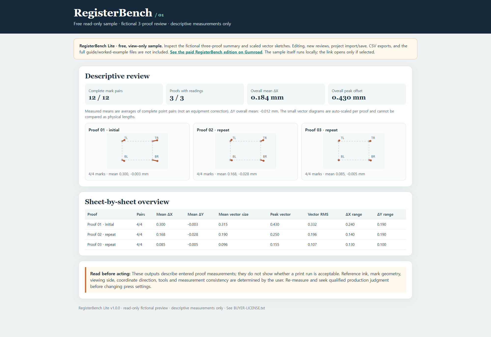
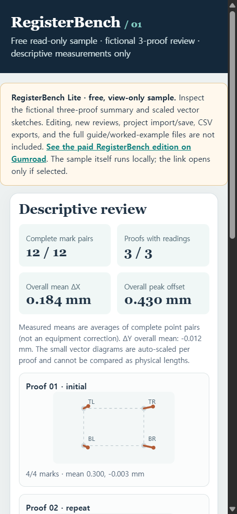

# RegisterBench Lite — Free Read-Only Proof Review Demo

**Explore a fictional proof-review sample in your browser — free, offline, and without installation.**

RegisterBench Lite is a self-contained HTML demonstration featuring three fictional proof examples, read-only summary metrics, sheet-by-sheet information, and scaled vector sketches.

No account, installation, or server is required for local use.

## Download RegisterBench Lite — Free

### [⬇ Download Free Lite ($0+)](https://mcjinster.gumroad.com/l/registerbench-lite)

*Actual browser screenshot of the RegisterBench Lite desktop interface. All proof examples and sample values are fictional.*

**Other ways to access the free sample:**

- [Download the original Lite ZIP from GitHub](https://github.com/mcjin87-eng/registerbench-lite-read-only-proof-review-demo/raw/refs/heads/main/RegisterBench-Lite-Free-Edition-v1.0.0.zip)
- [Download the original standalone HTML from GitHub](https://github.com/mcjin87-eng/registerbench-lite-read-only-proof-review-demo/raw/refs/heads/main/RegisterBench-Lite-Read-Only-Demo.html)
- [Download the official free edition on Gumroad](https://mcjinster.gumroad.com/l/registerbench-lite)

**Price:** $0 minimum, with optional pay-what-you-want support.

**Format:** Self-contained HTML application distributed in a ZIP archive.

## Try the Live Demo

### [Open RegisterBench Lite on GitHub Pages](https://mcjin87-eng.github.io/registerbench-lite-read-only-proof-review-demo/)

The GitHub Pages link is the intended live-demo address once GitHub Pages has been enabled and deployed.

The live demo uses an exact copy of the original HTML application.

The original HTML file and downloadable ZIP remain unchanged.

No backend or account is required.

The application runs locally without network requests unless the user follows the paid product link.

## What's Included in Lite?

### 1. Three Fictional Proof Examples

Explore three fixed fictional proof examples.

Each proof contains four fixed marks.

The examples demonstrate the interface and its read-only presentation.

They are not physical press-test results.

### 2. Read-Only Summary Metrics

Inspect the summary information associated with the fictional proof examples.

The displayed metrics are fixed sample values.

Lite does not provide editable reviews.

### 3. Sheet-by-Sheet Overview

Review the included proof examples through a sheet-by-sheet overview.

The overview is limited to the existing sample data.

Users cannot add proof sheets or create new reviews in Lite.

### 4. Scaled Vector Sketches

Explore the scaled vector sketches included in the demonstration.

The sketches are part of the fictional sample.

They should not be treated as validated physical testing results.

## Interface Preview

### Responsive Mobile View

*Actual browser screenshot of the RegisterBench Lite responsive mobile layout, using the same fictional demonstration data.*

The desktop and mobile screenshots show the actual HTML application rather than recreated interface illustrations.

The screenshots are previews of the Lite edition, not evidence of additional functionality.

## Download Package

**Original archive:**

`RegisterBench-Lite-Free-Edition-v1.0.0.zip`

The original ZIP contains exactly these four files:

| File | Description |
|---|---|
| `RegisterBench-Lite-Read-Only-Demo.html` | Standalone offline HTML demonstration |
| `START-HERE.txt` | Getting-started instructions, sample scope, and limitations |
| `BUYER-LICENSE.txt` | Permitted use and redistribution restrictions |
| `Lite-Files-SHA256.txt` | SHA-256 file integrity reference |

The original ZIP is preserved without modification.

Repository screenshots and the optional GitHub Pages deployment copy are separate from the original distribution archive.

## How to Use RegisterBench Lite

### Option A — Run Locally

1. Download `RegisterBench-Lite-Free-Edition-v1.0.0.zip`.
2. Extract the archive.
3. Read `START-HERE.txt`.
4. Open `RegisterBench-Lite-Read-Only-Demo.html` in your browser.
5. Explore the fictional proof examples, summary metrics, sheet-by-sheet overview, and scaled vector sketches.

No software installation or account registration is required.

### Option B — Use GitHub Pages

Open the hosted demonstration:

[Launch RegisterBench Lite](https://mcjin87-eng.github.io/registerbench-lite-read-only-proof-review-demo/)

The hosted version is intended to display the same original read-only HTML application.

GitHub Pages availability depends on the repository owner completing deployment.

## GitHub Pages Deployment

RegisterBench Lite is a self-contained HTML application.

GitHub Pages can serve the application directly without a build system or backend.

**Deployment decision: Use `index.html` as an unchanged copy of the original HTML file.**

Repository owner:

`mcjin87-eng`

Repository:

`registerbench-lite-read-only-proof-review-demo`

Deployment steps:

1. Upload the original ZIP without modification.
2. Keep the original HTML file under its existing filename.
3. Copy `RegisterBench-Lite-Read-Only-Demo.html` to `index.html` in the repository root.
4. Do not modify the HTML content when creating the copy.
5. Add both actual browser screenshots using the filenames shown below.
6. Enable GitHub Pages from the `main` branch and `/ (root)` directory.
7. Verify that the Pages URL opens the original read-only demonstration.

Expected repository structure:

    registerbench-lite-read-only-proof-review-demo/
    ├── README.md
    ├── index.html
    ├── RegisterBench-Lite-Read-Only-Demo.html
    ├── RegisterBench-Lite-Free-Edition-v1.0.0.zip
    ├── registerbench-lite-desktop-overview.png
    └── registerbench-lite-mobile-preview.png

`index.html` is a deployment copy, not an additional Lite download deliverable.

The original ZIP remains unchanged and retains its original four-file contents.

## Free Lite vs. Paid Full

| Capability | Free Lite | Paid Full |
|---|---|---|
| Proof examples | 3 fixed fictional examples | Worked examples included |
| Marks per example | 4 fixed marks | Refer to Full product details |
| Summary metrics | Read-only | Refer to Full product details |
| Sheet-by-sheet overview | Yes | Refer to Full product details |
| Scaled vector sketches | Yes | Refer to Full product details |
| Editable reviews | No | Yes |
| Blank or new reviews | No | Yes |
| Adding proof sheets | No | Up to 12 sheets |
| JSON backup | No | Yes |
| JSON import | No | Yes |
| CSV exports | No | Yes |
| Guide PDFs | Not included | Included |
| Worked-example PDFs | Not included | Included |

The Lite edition is intended for sample inspection and evaluation.

It is not a replacement for the editable Full edition.

## Need Editable Reviews?

The paid RegisterBench Full edition includes:

- Editable review workflows
- Support for up to 12 sheets
- JSON backup and import
- CSV exports
- Guide PDFs
- Worked-example PDFs

These capabilities are not included in the free Lite sample.

### [View RegisterBench Full on Gumroad](https://mcjinster.gumroad.com/l/abnlk)

The Full edition is a separate paid product.

## Important Scope and Limitations

RegisterBench Lite is a fixed, read-only demonstration.

The free edition does **not** support:

- Editing existing reviews
- Creating blank or new reviews
- Adding proof sheets
- JSON import or saving
- CSV export
- Access to the Full edition's guide PDFs
- Access to the Full edition's worked-example PDFs

All three included proof examples are fictional.

The sample contains four fixed marks per proof.

**No physical press testing is represented by this demonstration.**

The example values, metrics, and sketches must not be interpreted as independently validated physical test results.

## License and Redistribution

The original Lite distribution includes:

`BUYER-LICENSE.txt`

The buyer license permits:

- Personal evaluation
- Internal reference

The buyer license prohibits:

- Reselling the original HTML application
- Redistributing the original HTML application
- Reselling the original ZIP or bundled files
- Redistributing the original ZIP or bundled files

The free price does not make the application public-domain software.

**A free download is not a grant of redistribution rights.**

This repository and its GitHub Pages demonstration are published by the product owner as an authorized distribution of the owner's own free sample.

That owner-authorized publication does not grant third parties permission to republish, redistribute, repackage, mirror, or resell the HTML application or original bundle.

Visitors should use the official free download for personal evaluation or internal reference under the included buyer license.

The original `BUYER-LICENSE.txt` governs the downloaded Lite files.

No additional open-source license is granted by this README.

## File Integrity

The original ZIP includes:

`Lite-Files-SHA256.txt`

This file provides SHA-256 integrity reference information for the Lite files.

Retain the original integrity file with the original download.

The separate GitHub Pages `index.html` copy does not alter the original ZIP or its integrity reference.

## Official Links

| Resource | Link |
|---|---|
| Free Lite on Gumroad | [Download Free Lite](https://mcjinster.gumroad.com/l/registerbench-lite) |
| Original ZIP on GitHub | [Download ZIP](https://github.com/mcjin87-eng/registerbench-lite-read-only-proof-review-demo/raw/refs/heads/main/RegisterBench-Lite-Free-Edition-v1.0.0.zip) |
| Original HTML on GitHub | [Download HTML](https://github.com/mcjin87-eng/registerbench-lite-read-only-proof-review-demo/raw/refs/heads/main/RegisterBench-Lite-Read-Only-Demo.html) |
| GitHub Pages demo | [Open Live Demo](https://mcjin87-eng.github.io/registerbench-lite-read-only-proof-review-demo/) |
| Paid Full on Gumroad | [View Full Edition](https://mcjinster.gumroad.com/l/abnlk) |

---

**RegisterBench Lite — Free Read-Only Sample**

Explore the fictional demonstration for free, then review the paid Full edition if editable workflows and additional files are needed.

[Download Free Lite](https://mcjinster.gumroad.com/l/registerbench-lite) · [Explore Full Edition](https://mcjinster.gumroad.com/l/abnlk)